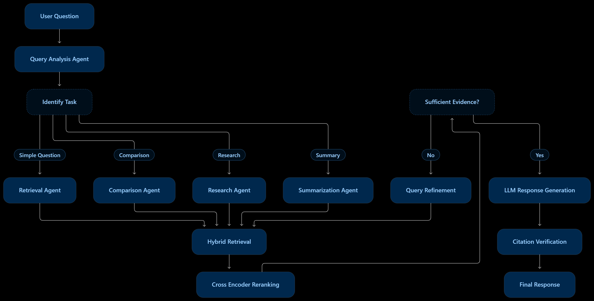

1. Project vision
Product name: DocMind AI

An intelligent, agentic document intelligence platform powered by LLMs and advanced RAG.

Core user experience
Imagine a user uploads these documents:
- 10 research papers.
- 5 financial reports.
- 3 PDF technical manuals.
- 2 Excel datasets.
The user can ask:
- What are the common findings across these research papers?
- Compare the financial performance of these companies.
- Identify contradictions between documents.
- Summarize the technical architecture.
- Generate a report based on the uploaded documents.
- Which document supports this particular statement?
The application should retrieve evidence, reason over it, and return an answer with verifiable citations.
Main features - Module	Features
Document management - Upload, delete, categorize, preview
Intelligent RAG - Hybrid search, reranking, query rewriting
AI agents - Research, comparison, summarization
Conversational AI - Contextual chat and memory
Data intelligence - Tables, calculations and charts
Citations - Document name, page and relevant passage
Workspace - Multiple users and document collections
Analytics - Retrieval quality, token usage and latency

2. Technology stack

Frontend
- Next.js (App Router)
- TypeScript
- Tailwind CSS
- shadcn/ui
- TanStack Query
- React Markdown

Backend
- Python
- FastAPI
- Pydantic
- SQLAlchemy
- Alembic
- Background workers

LLM and Agentic AI
- groq ai(i want use) or OpenAI API or another LLM provider
- LangGraph
- LangChain components where useful
- Structured Outputs
- Tool calling

RAG and retrieval
- PostgreSQL
- pgvector
- PostgreSQL full-text search (BM25 alternative: dedicated BM25 engine)
- Sentence Transformers
- Cross-encoder reranking

Infrastructure and monitoring
- Docker Compose
- Redis
- Langfuse
- GitHub Actions
- AWS or another cloud provider

3. Complete system architecture

Architecture layers
Layer 1 – Presentation layer
Next.js frontend:
- Authentication.
- Document upload.
- Chat interface.
- Document viewer.
- Source citations.
- Agent execution status.
- Analytics dashboard.

Layer 2 – API layer
FastAPI:
- Authentication and authorization.
- Document management APIs.
- Chat APIs.
- Retrieval APIs.
- Agent execution APIs.
- Streaming responses.

Layer 3 – Document ingestion layer
When a document is uploaded:
1. Validate the file.
2. Extract text and tables.
3. Preserve page numbers and metadata.
4. Clean and normalize extracted content.
5. Split content into chunks.
6. Generate embeddings.
7. Store chunks and vectors.
8. Index text for keyword search.

Layer 4 – Retrieval layer
For every question:
1. Analyze the user query.
2. Rewrite the query if necessary.
3. Run semantic retrieval.
4. Run keyword retrieval.
5. Merge results using Reciprocal Rank Fusion.
6. Apply cross-encoder reranking.
7. Select the most relevant passages.

Layer 5 – Agent layer
LangGraph orchestrates specialized agents:
- Query analysis agent.
- Document retrieval agent.
- Research agent.
- Comparison agent.
- Summarization agent.
- Response verification agent.

Layer 6 – LLM layer
The LLM generates answers using retrieved context and returns structured citations.

4. Agentic RAG workflow

Agent design
Agent	Responsibility
Supervisor	Understands user intent and routes tasks
Retriever	Finds relevant document passages
Researcher	Investigates multi-part questions
Comparator	Compares information across documents
Summarizer	Produces structured summaries
Verifier	Checks whether claims have supporting evidence

We will not make every operation an autonomous agent. Deterministic operations such as file validation, chunking and database writes should remain ordinary backend functions. Agents should be used where decisions and tool selection are genuinely useful.

5. Repository structure
We will maintain a monorepo so frontend, backend, AI pipelines and infrastructure remain organized.
docmind-ai/
│
├── frontend/
│   ├── app/
│   │   ├── (auth)/
│   │   ├── dashboard/
│   │   ├── documents/
│   │   ├── chat/
│   │   ├── research/
│   │   ├── settings/
│   │   ├── layout.tsx
│   │   └── page.tsx
│   │
│   ├── components/
│   │   ├── ui/
│   │   ├── chat/
│   │   ├── documents/
│   │   ├── citations/
│   │   └── dashboard/
│   │
│   ├── hooks/
│   ├── lib/
│   ├── services/
│   ├── types/
│   └── package.json
│
├── backend/
│   ├── app/
│   │   ├── main.py
│   │   ├── api/
│   │   │   ├── routes/
│   │   │   └── dependencies.py
│   │   │
│   │   ├── core/
│   │   │   ├── config.py
│   │   │   ├── security.py
│   │   │   └── logging.py
│   │   │
│   │   ├── ingestion/
│   │   │   ├── loaders.py
│   │   │   ├── extractors.py
│   │   │   ├── chunking.py
│   │   │   └── pipeline.py
│   │   │
│   │   ├── embeddings/
│   │   │   └── embedding_service.py
│   │   │
│   │   ├── retrieval/
│   │   │   ├── semantic_search.py
│   │   │   ├── keyword_search.py
│   │   │   ├── hybrid_search.py
│   │   │   ├── fusion.py
│   │   │   └── reranker.py
│   │   │
│   │   ├── agents/
│   │   │   ├── state.py
│   │   │   ├── supervisor.py
│   │   │   ├── researcher.py
│   │   │   ├── comparator.py
│   │   │   ├── summarizer.py
│   │   │   ├── verifier.py
│   │   │   └── workflow.py
│   │   │
│   │   ├── llm/
│   │   │   ├── provider.py
│   │   │   ├── prompts.py
│   │   │   └── response.py
│   │   │
│   │   ├── database/
│   │   │   ├── models.py
│   │   │   ├── session.py
│   │   │   └── repositories.py
│   │   │
│   │   ├── services/
│   │   └── schemas/
│   │
│   ├── tests/
│   ├── migrations/
│   └── requirements.txt
│
├── evaluation/
│   ├── datasets/
│   ├── retrieval_metrics.py
│   ├── rag_evaluation.py
│   └── agent_evaluation.py
│
├── infrastructure/
│   ├── docker/
│   └── docker-compose.yml
│
├── docs/
│   ├── architecture.md
│   ├── api-documentation.md
│   └── development-roadmap.md
│
├── .env.example
├── .gitignore
└── README.md

This structure separates the application into independently testable modules.

Engineering principle: Keep the RAG pipeline independent of LangGraph. Agents should call retrieval services through well-defined interfaces rather than containing all retrieval logic themselves.

6. Database design
Table	Important fields
users	id, email, password_hash
workspaces	id, owner_id, name
documents	id, workspace_id, filename, status
document_chunks	id, document_id, content, embedding, page_number
conversations	id, workspace_id, title
messages	id, conversation_id, role, content
citations	id, message_id, chunk_id
agent_runs	id, conversation_id, status, execution_trace
.png>)
Important database decisions
- Store original files in object storage, not directly in PostgreSQL.
- Store document metadata in PostgreSQL.
- Store embeddings using pgvector.
- Preserve page numbers, chunk IDs and document ownership.
- Enforce workspace-level authorization on every retrieval query.
- Store conversation history separately from retrieved document context.

7. Detailed RAG pipeline implementation
This is the most technically important component of the first project.
A. Document ingestion
Recommended libraries:
Library	Purpose
PyMuPDF	PDF extraction
python-docx	DOCX extraction
pandas	CSV and Excel
Unstructured	Complex document extraction
Sentence Transformers	Embeddings and reranking

our initial pipeline:
def ingest_document(file):
    # 1. Validate uploaded document
    validate_file(file)

    # 2. Extract text and metadata
    pages = extract_document(file)

    # 3. Split into chunks
    chunks = create_chunks(
        pages,
        chunk_size=800,
        chunk_overlap=120
    )

    # 4. Generate embeddings
    embeddings = embedding_service.embed_documents(
        [chunk["content"] for chunk in chunks]
    )

    # 5. Store chunks, metadata and embeddings
    save_chunks(chunks, embeddings)

    # 6. Update document status
    update_document_status("completed")
These chunking values are initial experimental settings, not universal optimal values. We will benchmark different strategies against a test dataset.
B. Hybrid retrieval
We will implement two independent retrieval mechanisms.

Semantic retrieval

Uses vector similarity to find passages with related meanings.

Keyword retrieval

Finds passages matching important terms, names, technical expressions and identifiers.

Combine them using Reciprocal Rank Fusion:
\[
RRF(d)=\sum_{i=1}^{n}\frac{1}{k+rank_i(d)}
\]

Here:
- \(d\) = retrieved document chunk.
- \(rank_i(d)\) = its rank in retrieval system \(i\).
- \(k\) = ranking constant.
C. Cross-encoder reranking
After merging retrieval results, use a cross-encoder to score the relationship between each query and retrieved passage.

Example model:

cross-encoder/ms-marco-MiniLM-L-6-v2

Pipeline:
.png>)
D. Evaluation
Do not judge RAG quality only by whether an answer sounds correct.

Measure:
Metric	What it measures
Recall@K	Whether relevant passages are retrieved
Precision@K	How many retrieved passages are relevant
MRR	Ranking quality of the first relevant result
NDCG@K	Quality of the overall ranking
Faithfulness	Whether answers are supported by evidence
Answer relevance	Whether the answer addresses the question
Citation accuracy	Whether cited passages support claims

We will compare:
1. Vector search only.
2. Keyword search only.
3. Hybrid retrieval.
4. Hybrid retrieval + reranking.
This comparison will give you measurable engineering results for your portfolio.

8. Frontend development plan
The interface is just as important as the AI backend.

I recommend a clean, professional SaaS-style interface.
Main pages
Page	Functionality
Landing page	Product introduction and login
Dashboard	Workspace overview and recent activity
Documents	Upload, search and manage files
AI Chat	Ask questions and receive citations
Research	Multi-step research workflows
Compare	Compare two or more documents
Agent Monitor	Inspect agent execution
Settings	User and workspace settings

Frontend interaction requirements
Your application should support:
- Streaming responses instead of waiting for a complete answer.
- Drag-and-drop document uploads.
- Real-time ingestion status.
- Clickable citations that open the correct document page.
- Markdown rendering and code highlighting.
- Skeleton loaders.
- Error states and retry mechanisms.
- Mobile-responsive layouts.
- Accessible keyboard navigation.
For streaming, use Server-Sent Events initially. You can introduce WebSockets if you later need bidirectional real-time communication.

9. API design
Build your backend around clear REST endpoints.
Method	Endpoint	Purpose
POST	/api/documents/upload	Upload document
GET	/api/documents	List documents
GET	/api/documents/{id}	Get document details
DELETE	/api/documents/{id}	Delete document
POST	/api/chat	Submit question
GET	/api/chat/{id}/stream	Stream response
GET	/api/conversations	List conversations
POST	/api/agents/research	Start research task
POST	/api/documents/compare	Compare documents
GET	/api/agents/runs/{id}	Inspect agent execution

For streaming, we will define a consistent event format for answer tokens, citations, tool activity, completion and errors.

10. Production engineering requirements
A portfolio project becomes significantly more impressive when you address real-world failure cases.

Security
- Validate MIME types and file sizes.
- Prevent path traversal and unsafe file parsing.
- Isolate documents by workspace.
- Protect API keys and credentials.
- Defend against indirect prompt injection inside uploaded documents.
- Treat retrieved content as untrusted data.
- Require user approval for consequential tool actions.
Performance
- Process documents asynchronously.
- Cache frequently accessed data.
- Batch embedding requests.
- Avoid unnecessary LLM calls.
- Stream model responses.
- Add database indexes.
Reliability
- Retry transient failures.
- Make ingestion jobs idempotent.
- Track failed document processing.
- Handle provider rate limits.
- Maintain structured logs.
Observability

Use Langfuse to inspect:
- Prompt and response traces.
- Retrieval results.
- Agent tool calls.
- Token consumption.
- Latency.
- Errors and evaluation scores.